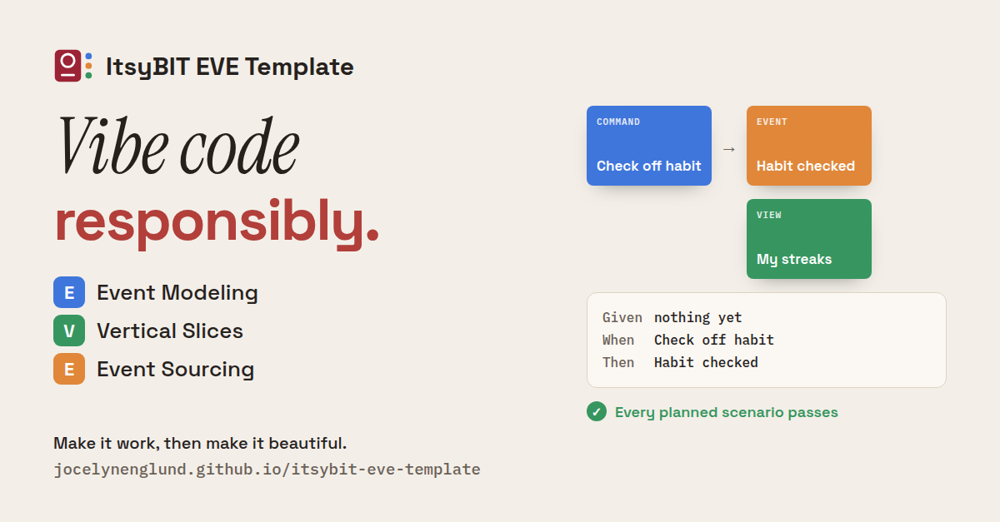

# ItsyBIT EVE Template · beta



**E**vent modeling · **V**ertical slices · **E**vent sourcing

> **Beta.** It works end to end (plan, refine, build, make it beautiful, update), and it is still changing. Tell your AI **update EVE** now and then; your plan and app are never touched.

A starting point for building an app with your AI assistant. You and the AI agree on a plan first, in an **Event Book** you can comment on. Then the AI builds it slice by slice, tests first, and you open the finished app in your browser.

**See it:** [the sample's Event Book](https://jocelynenglund.github.io/itsybit-eve-template/eve/book.html?root=sample/todo/) · [the sample app](https://jocelynenglund.github.io/itsybit-eve-template/eve/sample/todo/app/)

## TL;DR

```
git clone https://github.com/jocelynenglund/itsybit-eve-template my-app
cd my-app
claude        # or Cursor, Codex, any assistant that reads AGENTS.md
```

You need [Node](https://nodejs.org) 18 or newer, nothing else. Want your own repo on GitHub (it can be private)? Press **Use this template** and clone that instead.

Then just talk to it. This is a real session, a storage-box tracker built in an afternoon, with every message the person typed:

| You say | What happens |
|---|---|
| *let's plan an app to track my boxes that i put into storage. I basically want to be able to make a qr code for my boxes that are linked to a list of things that are in it. so it makes knowing what's in the boxes easier.* | The AI writes the plan and opens the Event Book at http://localhost:4747. You comment, add scenarios and tick **Refined**, then press **Done with feedback**. |
| *done with feedback* | It answers every comment and serves the next round. Repeat until every slice is refined. |
| *start building* | It builds each slice test-first. The book turns green as tests pass; the app is at http://localhost:4747/app/. |
| *I want to add a feature that shows me a view of which boxes i have taken things out of most often so i can maybe reorganize better.* | It adds the new slices to the plan. Built slices fold away in the book, so the new ones stand out. Refine, then *start building* again. |
| *make it beautiful* | It turns the plan into a design brief and sends it to your design tool, then restyles the app. Every test still has to pass. |
| *update EVE* | It gets the newest EVE tools and leaves your plan and app alone. |

## How it goes

1. **Make your own copy:** press **Use this template** on GitHub (it can be private), then clone your copy. Or download the zip. Open your AI assistant in it: Claude Code, Cursor, Codex or anything that reads `AGENTS.md`.
2. Say **"let's plan a todo app"** (or your idea). The AI writes `plan/model.json` and starts the Event Book at http://localhost:4747.
3. **In the Event Book**, read each slice: what someone can do or see, with Given / When / Then examples. Comment on a slice, a scenario, or one line of it. Add scenarios you're missing. Tick **Refined** when a slice is right. Press **Done with feedback**.
4. Tell the AI **"done"**. It reads your round (`plan/feedback/round-N.json`), answers every comment, updates the plan, and the book shows the next round. Repeat until every slice is refined.
5. Say **"start building"**. The AI builds each slice like `eve/sample/todo/`: tests from your scenarios first, then the code. The book turns each scenario green as its test passes.
6. See your app: the Event Book's **App** tab shows it at phone or laptop size, or open **http://localhost:4747/app/**.
7. Fill in the **Look** tab of the Event Book (the mood, colours, apps you like the look of, where it gets used), then say **"make it beautiful"**. The AI turns your plan and your look into a design brief: every screen, action and message, with example content. Your design tool (Claude Design, Figma, v0, Lovable, whatever you use) makes three directions from it, or the AI makes them itself. The one you pick restyles the app, and every test still has to pass.

You need [Node](https://nodejs.org) 18 or newer. There's nothing to install.

## Getting newer versions of EVE

When EVE gets better, your Event Book says so. Tell your AI **"update EVE"**, or run `node eve/update.mjs` yourself. It replaces EVE's own files (`eve/` and the `eve-*` skills) with the newest ones and never touches anything else. It works however you made your copy, git or not. `node eve/update.mjs --check` only says whether there's a newer one.

## What's where

Everything at the top level is yours; everything EVE is in `eve/`. Your first plan replaces this README with one about your app.

```
my-app/
  app/        your app
  plan/       its plan, your feedback rounds and the test results
  design/     its design, once you've said "make it beautiful"
  README.md   about your app
  AGENTS.md   your notes for the AI about this app (points it at eve/AGENTS.md)
  eve/        EVE itself: "update EVE" replaces it, nothing else
```

| In `eve/` | What it is |
|---|---|
| `AGENTS.md` | How the AI works here: the loop, the plan format, the code rules. |
| `book.html` | The Event Book: Book, Board, App, Look and Export tabs. |
| `serve.mjs` | Serves the book and your app, and saves your feedback rounds. `node eve/serve.mjs` |
| `test.mjs` | Runs your app's tests, writes `plan/built.json`, and says how many planned scenarios pass. |
| `init.mjs` | Makes a fresh copy yours at the first plan (your README; the template's own files go). |
| `brief.mjs` | Writes `plan/design-brief.md`, your plan as a brief for a design tool. |
| `eventmodelers.mjs` | Exports the plan for [eventmodelers.ai](https://eventmodelers.ai) (EM-Studio by Nebulit), for a team or AI agents. Also the **Export** tab. |
| `update.mjs` | Updates EVE to the newest version. `node eve/update.mjs` |
| `sample/todo/` | A small app planned and built this way. Try `node eve/serve.mjs eve/sample/todo`. |
| `site/` | This template's own website. |

The skills (`eve-plan`, `eve-refine`, `eve-build`, `eve-design`) are in `.claude/skills/`, where Claude Code looks for them. They're plain markdown, so other assistants can follow them too.

## The shape of an EVE app

- The only thing stored is a list of **events**: facts like `TodoAdded`. Everything on screen is worked out from them.
- Each thing a person can do is a **command slice**: a folder with a pure `decide(history, command)` that returns new events or refuses with a reason, plus its tests.
- Each thing a person can see is a **view slice**: a pure `project(history)`, plus its tests.
- Every test is one of the Given / When / Then scenarios you agreed in the Event Book, with the same title. That's how the book knows what's built.

The Event Book's files use the same names as the full Event Book app (`CommentAdded`, `ScenarioAdded`, `SliceMarkedRefined`, and Given/When/Then scenario exports), but you don't need anything beyond this repo.

## Credits

**Event Modeling** is [Adam Dymitruk](https://eventmodeling.org/about/)'s method: planning a system as a timeline of events, the commands that cause them and the views that show them, with Given/When/Then scenarios for each slice. EVE's Event Book and planning loop are built on it. Read more at [eventmodeling.org](https://eventmodeling.org/about/).

## For maintainers

Bump `eve/version.json` (a date: `2026-11-01`, then `2026-11-01.2`, `.3` … for more releases that day) and add a line to its `releases` (what changed, in the words of someone using EVE) whenever `eve/` or the `eve-*` skills change. When `eve/sample/todo/app/lib/store.js` or `gwt.mjs` changes, add its sha256 to `SHIPPED` in `eve/update.mjs`, so untouched copies in people's apps get updated. The website's files are in `eve/site/`; `.github/workflows/pages.yml` assembles and publishes them (old links keep working). That's how people's Event Books know there's a newer EVE. `eve/update.mjs` downloads `main`, so keep `main` working, and keep reading old `plan/model.json` files.

## License

MIT (`LICENSE`, and `eve/LICENSE` in people's copies).
