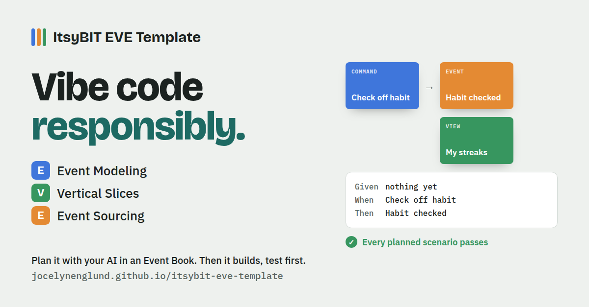

# ItsyBIT EVE Template



**E**vent modeling · **V**ertical slices · **E**vent sourcing

A starting point for building an app with your AI assistant. You and the AI agree on a plan first, in an **Event Book** you can comment on. Then the AI builds it slice by slice, tests first, and you open the finished app in your browser.

**See it:** [the sample's Event Book](https://jocelynenglund.github.io/itsybit-eve-template/eve/book.html?root=../sample/todo/) · [the sample app](https://jocelynenglund.github.io/itsybit-eve-template/sample/todo/app/)

## TL;DR

```
git clone https://github.com/jocelynenglund/itsybit-eve-template my-app
cd my-app
claude        # or Cursor, Codex, any assistant that reads AGENTS.md
```

You need [Node](https://nodejs.org) 18 or newer, nothing else. Want your own repo on GitHub (it can be private)? Press **Use this template** and clone that instead.

Then just talk to it. This is a real session, a storage-box tracker built in an afternoon, with every message the person typed:

| You say | What happens |
|---|---|
| *let's plan an app to track my boxes that i put into storage. I basically want to be able to make a qr code for my boxes that are linked to a list of things that are in it. so it makes knowing what's in the boxes easier.* | The AI writes the plan and opens the Event Book at http://localhost:4747. You comment, add scenarios and tick **Refined**, then press **Done with feedback**. |
| *done with feedback* | It answers every comment and serves the next round. Repeat until every slice is refined. |
| *start building* | It builds each slice test-first. The book turns green as tests pass; the app is at http://localhost:4747/app/. |
| *I want to add a feature that shows me a view of which boxes i have taken things out of most often so i can maybe reorganize better.* | It adds the new slices to the plan. Built slices fold away in the book, so the new ones stand out. Refine, then *start building* again. |
| *make it beautiful* | It turns the plan into a design brief and sends it to your design tool, then restyles the app. Every test still has to pass. |
| *update EVE* | It gets the newest EVE tools and leaves your plan and app alone. |

## How it goes

1. **Make your own copy:** press **Use this template** on GitHub (it can be private), then clone your copy. Or download the zip. Open your AI assistant in it: Claude Code, Cursor, Codex or anything that reads `AGENTS.md`.
2. Say **"let's plan a todo app"** (or your idea). The AI writes `plan/model.json` and starts the Event Book at http://localhost:4747.
3. **In the Event Book**, read each slice: what someone can do or see, with Given / When / Then examples. Comment on a slice, a scenario, or one line of it. Add scenarios you're missing. Tick **Refined** when a slice is right. Press **Done with feedback**.
4. Tell the AI **"done"**. It reads your round (`plan/feedback/round-N.json`), answers every comment, updates the plan, and the book shows the next round. Repeat until every slice is refined.
5. Say **"start building"**. The AI builds each slice like `sample/todo/`: tests from your scenarios first, then the code. The book turns each scenario green as its test passes.
6. Open **http://localhost:4747/app/**. That's your app.
7. Fill in **Look and feel** at the top of the Event Book (the mood, colours, apps you like the look of, where it gets used), then say **"make it beautiful"**. The AI turns your plan and your look into a design brief, asks your design tool for three directions to pick from (or makes them itself) (every screen, action and message, with example content). Your design tool is Claude Design, Figma, v0, Lovable, whatever you use. The one you pick restyles the app, and every test still has to pass.

You need [Node](https://nodejs.org) 18 or newer. There's nothing to install.

## Getting newer versions of EVE

When EVE gets better, your Event Book says so. Tell your AI **"update EVE"**, or run `node eve/update.mjs` yourself. It replaces EVE's own files (`eve/`, the `eve-*` skills, `AGENTS.md`, `sample/`) with the newest ones and never touches your `plan/` or `app/`. It works however you made your copy, git or not. `node eve/update.mjs --check` only says whether there's a newer one.

## What's here

| Path | What it is |
|---|---|
| `AGENTS.md` | How the AI works in this repo: the loop, the plan format, the code rules. `CLAUDE.md` loads it for Claude Code. |
| `.claude/skills/` | `eve-plan`, `eve-refine`, `eve-build`, `eve-design`: the step-by-step for each phase. Plain markdown, so other assistants can follow them too. |
| `eve/book.html` | The Event Book. |
| `eve/serve.mjs` | Serves the book and your app, and saves your feedback rounds. `node eve/serve.mjs` |
| `eve/brief.mjs` | Writes `plan/design-brief.md`, your plan as a brief for a design tool. `node eve/brief.mjs` |
| `eve/update.mjs` | Updates the EVE tools to the newest version, leaving your plan and app alone. `node eve/update.mjs` |
| `eve/test.mjs` | Runs your app's tests, writes `plan/built.json`, and says how many planned scenarios pass. `node eve/test.mjs` |
| `sample/todo/` | A small app planned and built this way: its plan, its feedback threads and its code. Try `node eve/serve.mjs sample/todo`. |
| `plan/`, `app/` | Where your plan and your app go. |

## The shape of an EVE app

- The only thing stored is a list of **events**: facts like `TodoAdded`. Everything on screen is worked out from them.
- Each thing a person can do is a **command slice**: a folder with a pure `decide(history, command)` that returns new events or refuses with a reason, plus its tests.
- Each thing a person can see is a **view slice**: a pure `project(history)`, plus its tests.
- Every test is one of the Given / When / Then scenarios you agreed in the Event Book, with the same title. That's how the book knows what's built.

The Event Book's files use the same names as the full Event Book app (`CommentAdded`, `ScenarioAdded`, `SliceMarkedRefined`, and Given/When/Then scenario exports), but you don't need anything beyond this repo.

## For maintainers

Bump `eve/version.json` (a date: `2026-11-01`, or `2026-11-01.2` for a second release that day) whenever `eve/`, the `eve-*` skills, `AGENTS.md` or `sample/` change. That's how people's Event Books know there's a newer EVE. `eve/update.mjs` downloads `main`, so keep `main` working, and keep reading old `plan/model.json` files.

## License

MIT
